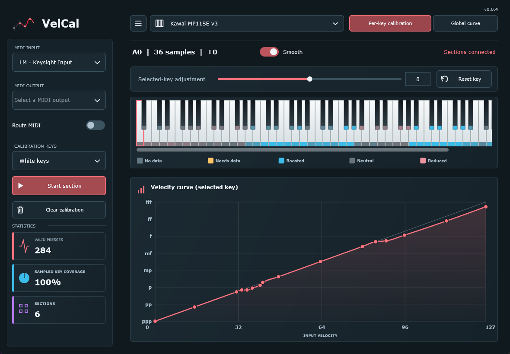
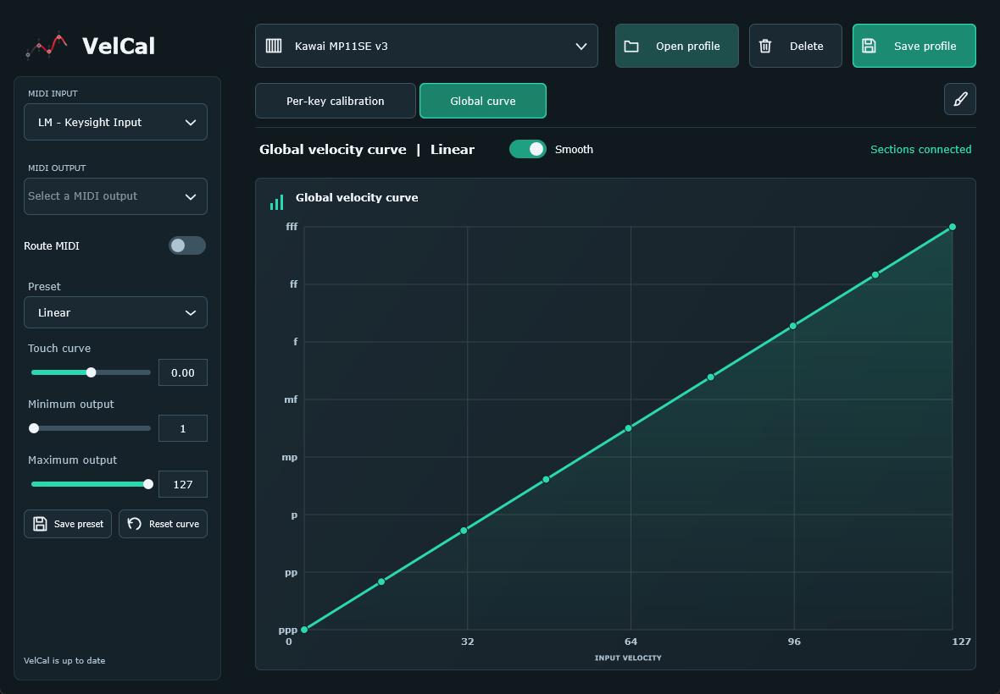

# VelCal

VelCal is a free, open-source app for making the velocity response of a MIDI
keyboard more consistent from key to key. If some keys play noticeably louder
or quieter than others under a similar touch, VelCal can measure those
differences and adjust the MIDI sent to your DAW or software instrument.

It sits between your keyboard and your instrument. It changes MIDI velocity,
not audio, and does not change your keyboard's built-in sounds or repair its
physical action.

**[Download VelCal](https://github.com/SH4DOWSIX/VelCal/releases/latest)**

Installers include standalone and VST3 on Windows, Linux, and
macOS, plus an AU MIDI effect for Logic on macOS. VelCal has been tested on
Windows, Linux Mint, and macOS. Testing is most extensive on Windows;
Linux Mint and macOS testing has confirmed standalone MIDI input/output and
plugin loading (VST3, plus AU on macOS). See
[installation and DAW routing](docs/INSTALLING.md) and
[0.0.4 release notes](docs/releases/0.0.4.md), including unsigned-installer warnings
and build-verification status.

## What You Can Do

- Automatically calibrate each key's velocity response by pressing groups in
  short, overlapping sections, with separate passes for white and black keys.
- Fine-tune individual keys with an adjustment slider or editable velocity curve.
- Shape the whole keyboard's response with a global velocity curve, built-in
  presets, and your own saved presets.
- Toggle smoothing for the per-key curves and global curve independently.
- Save and reload calibration profiles, and recall plugin settings with your
  DAW project.
- Send corrected MIDI to your DAW or software instrument while preserving
  pedals, pitch bend, and other MIDI messages.

## Screenshots

**Per-key calibration**: compact profile and tab controls, keyboard coverage,
section statistics, and the selected key's velocity curve.



**Global curve**: shape the whole keyboard's response with shared presets, touch
curve, and output limits.



## Get Started

1. Run the installer for your operating system and choose standalone and/or
   plugins. Open standalone from your applications menu, or load the plugin
   in your DAW following the [routing guide](docs/INSTALLING.md#daw-routing).
2. Connect your keyboard. In standalone select it under **MIDI input**; in a
   plugin select the input in your DAW instead.
3. In the profile menu, select **New profile** to start a calibration, or **Open profile** to load one
   you have already saved.

You do not need to set up a MIDI output just to calibrate. Set up routing when
you are ready to play through your DAW.

<details>
<summary><strong>Calibrate Your Keyboard</strong></summary>

**Use a straight edge 50 cm or shorter.** Shorter sections cover fewer keys and
require less force to press together, making firm presses easier to control
and the required velocities easier to reach.

Use a rigid object with a straight, smooth edge, such as a straight piece of
wood or a spirit level. Keep it clean, with a thin, even protective layer if
needed to prevent scratches.

VelCal groups presses by their median MIDI velocity:

| Press | Median velocity |
|---|---|
| Soft | 1-42 |
| Medium | 43-84 |
| Firm | 85-127 |

Higher velocities require faster key movement. A firm, fast press on one key
can make a mechanical thump as it reaches the bottom of its travel; pressing
a group together can make a much louder thump. **Stop if you feel uncomfortable
or need excessive force.** Try a shorter section rather than hitting harder.

1. In **Per-key calibration**, choose **White keys** under **Calibration keys**.
   Rest the straight edge across a short group of white keys at their front
   ends, closest to you. Keep it parallel to the keyboard's front edge so it
   contacts every key at the same distance from its front end, not diagonally.
2. Select **Start section**, read the guide, then select **Begin capture**.
3. Apply the downward force at the centre of the straight edge's length to
   help distribute it evenly across the keys. Keep the edge level and in the
   same position throughout the section. Avoid rocking or flexing, which can
   distort the measurements.
   Mix soft, medium, and firm presses, fully releasing the keys each time.
   The first few presses identify which keys are under the bar.
4. Follow the live guidance until the section is ready. Each covered key needs
   at least eight accepted soft, eight medium, and eight firm measurements.
   Incomplete or inconsistent presses may not count, so this can take more
   than 24 presses.
5. Select **Finish section**. Move the bar along the keyboard, overlapping the
   previous section by at least two white keys (three or four is better), and
   repeat for the range you want to calibrate.
6. Choose **Black keys** and repeat the process for the black keys, overlapping
   each new black-key section with the previous one.
7. Select **Save** in the profile menu when you are finished.

Overlap lets VelCal compare neighbouring sections within each key colour.
You can calibrate just the range you use; uncalibrated keys have no automatic
per-key correction.

If firm samples still will not register with a shorter edge, check whether
individual keys comfortably reach velocity 85 or above. Report persistent
difficulty with your keyboard model, edge length, number of covered keys, and
observed velocities.

The keyboard display helps you check progress: amber means a key still needs
data; cyan means it is being boosted; red means it is being reduced; grey means
it is already close to neutral. A key without a status strip has no measurements.

</details>

<details>
<summary><strong>Play Through Your DAW</strong></summary>

With VST3, load VelCal as an instrument on its own track, then select that
instance as the piano track's MIDI input. It is not an audio insert. With Logic,
load the AU version in the piano track's MIDI FX slot, before the instrument.
Plugins include calibration and all editing features; the DAW selects devices.

For standalone, the MIDI path should be:

```text
Keyboard -> VelCal -> MIDI port -> DAW or software instrument
```

Set up a virtual MIDI connection using the instructions for your platform below.
These connections carry MIDI, not audio. Have the instrument track listen to
the virtual port rather than also receiving the physical keyboard directly,
otherwise you may hear duplicate notes or uncorrected notes. Do not send the
DAW's MIDI output back into VelCal's input.

### Windows

Use [loopMIDI](https://www.tobias-erichsen.de/software/loopmidi.html), or another
installed virtual MIDI cable.

1. Install and open loopMIDI. Use its **+** button to create a port named
   `VelCal Output`, and keep loopMIDI running.
2. Start or restart VelCal so the port appears. Select your keyboard as
   **MIDI input** and `VelCal Output` as **MIDI output**.
3. In your DAW, select that same port as the instrument track's MIDI input.
   Load a software instrument and enable the track's monitoring as needed.
4. Load your saved profile in VelCal and enable **Route MIDI**.

### macOS

Use the built-in **IAC Driver**; no additional virtual MIDI software is needed.

1. Open **Audio MIDI Setup** and choose **Window > Show MIDI Studio**.
2. Double-click **IAC Driver** and enable **Device is online**.
3. Add a bus named `VelCal Output` and click **Apply**.
4. Start or restart VelCal. Select your keyboard as **MIDI input** and the IAC
   bus you created as **MIDI output**; its name may include `IAC Driver`.
5. Select the same bus as your instrument track's MIDI input in the DAW.
   Enable track monitoring, load your VelCal profile, and enable **Route MIDI**.

See [Apple's IAC setup guide](https://support.apple.com/guide/audio-midi-setup/transfer-midi-information-between-apps-ams1013/mac).

### Linux

Use the free **ALSA MIDI Through** port, which forwards incoming MIDI to
applications listening to it.

1. Look for `Midi Through` in your available MIDI devices. If it is missing,
   enable the kernel module in a terminal:

   ```sh
   sudo modprobe snd-seq-dummy
   ```

2. Start or restart VelCal. Select your keyboard as **MIDI input** and
   `Midi Through Port-0` (or its corresponding displayed name) as **MIDI output**.
3. Select the matching MIDI Through port as your DAW instrument track's input.
   Enable track monitoring, load your VelCal profile, and enable **Route MIDI**.

The module must be available in your distribution's kernel. If the port is
missing again after reboot, reload the module or configure your distribution
to load it at startup. If your DAW requires external ALSA connections, use
`aconnect` from `alsa-utils` or [QjackCtl](https://github.com/rncbc/qjackctl)'s
ALSA connection view. DAWs using only JACK MIDI may also need an ALSA-to-JACK
bridge.

See the [ALSA MIDI Through implementation](https://github.com/torvalds/linux/blob/master/sound/core/seq/seq_dummy.c)
and [aconnect documentation](https://github.com/alsa-project/alsa-utils/blob/master/seq/aconnect/aconnect.1).
Standalone MIDI input/output has been confirmed on Linux Mint and macOS.
Broader DAW routing and calibration testing remains ongoing.

</details>

<details>
<summary><strong>Adjust The Feel</strong></summary>

In **Per-key calibration**, select a key on the displayed keyboard to adjust
it individually. Drag points on its curve, click to add a point, or right-click
an interior point to remove it. **Reset key** returns it to automatic calibration.

**Smooth** on this tab applies to all keys together, not just the selected key,
and defaults to on for new profiles. Automatic smoothing softens quantization
kinks while staying within one velocity step of the calibrated map. Switch it
off to use the original generated map. Toggling Smooth preserves measurements,
manual control points and adjustments; **Reset key** preserves the Smooth choice.

In **Global curve**, choose a preset or edit the curve to change the response
of the whole keyboard after the individual key corrections. Its independent
**Smooth** setting switches between smooth interpolation and straight lines
between points. **Save preset** immediately saves a named curve to a shared
library, available across profiles in standalone and plugins. Replacing a name
requires confirmation; **Rename** and **Delete** manage the selected library
preset. Applying a preset copies its curve into the profile, so later library
changes do not alter existing profiles or DAW projects. Older profile-local
presets remain available with a `(profile)` suffix; apply one and select
**Save preset** to add it to the shared library.

</details>

<details>
<summary><strong>Profiles And Appearance</strong></summary>

The menu button immediately left of the profile selector provides **New profile**,
**Open profile**, **Save**, **Save As**, **Reset All** and **Delete profile**
on both tabs. **Save** updates the current file,
asking for a filename on the first save. **Save As** saves a separate copy and
switches to it, preserving the original file. Profile changes are not saved
automatically; closing standalone or replacing an edited profile offers
**Save / Discard / Cancel**. Cancelling or failing a save keeps the current edits
and stops the pending action.

**Clear calibration** in the calibration sidebar removes measurements, per-key
curves and trims while preserving the global curve and calibration settings.
**Reset All** also restores the global curve and profile settings to defaults,
keeping the profile name, file association and saved presets. Both require
confirmation and leave the file unchanged until you save. **Delete** confirms
before removing the current profile file and discarding its unsaved edits.
The profile selector displays saved filenames without `.velcal.json`, rather
than internal profile or MIDI-device names. It also identifies unsaved profiles
and an empty library.

Installed builds keep profiles/preferences in writable per-user storage and
preserve them on uninstall. See [profile locations](docs/INSTALLING.md#profiles-and-updates).
Back up important profiles. Plugin project state includes completed profiles
and edits, even if the original profile file is later missing, but not unfinished
calibration captures.

Select **Accent colour** in the profile menu to choose an accent colour.
The choice takes effect immediately, is remembered across restarts, and is shared
by standalone and plugin editors. It does not alter your calibration profiles.

The small version label above **Global curve** shows the installed version
(for example, `v0.0.4`). When a newer release is found, it shows
`v0.0.4 - v0.0.5 is available`. Check details are in its tooltip; checking or an unavailable
check leaves the installed version visible. It does not download or install updates automatically;
use the [release downloads](https://github.com/SH4DOWSIX/VelCal/releases/latest)
to update. Your saved profiles/preferences are retained during an upgrade.

</details>

<details>
<summary><strong>Notes And Help</strong></summary>

- The display always shows 88 keys, even for smaller keyboards; MIDI processing
  supports all 128 MIDI notes.
- Different octave naming conventions are not a problem: VelCal uses MIDI note
  numbers. Keep your keyboard's transpose/octave-shift settings unchanged
  between calibration and playing.
- This is an early release. There is no undo/redo or individual section removal
  yet. If routing stops or behaves unexpectedly, bypass the plugin or disable
  standalone's **Route MIDI**, and
  check your MIDI connections for a feedback loop.
- Found a problem, especially on Linux or macOS?
  [Open an issue](https://github.com/SH4DOWSIX/VelCal/issues/new) with your OS,
  keyboard, DAW, and steps to reproduce it.

</details>

<details>
<summary><strong>Development</strong></summary>

Want to build or contribute? See the [build guide](docs/BUILDING.md) and
[architecture overview](docs/architecture.md). The detailed project handoff
is in [docs/PLAN.md](docs/PLAN.md).

</details>

<details>
<summary><strong>Licence</strong></summary>

AGPL-3.0-only. See [LICENSE](LICENSE).

</details>
